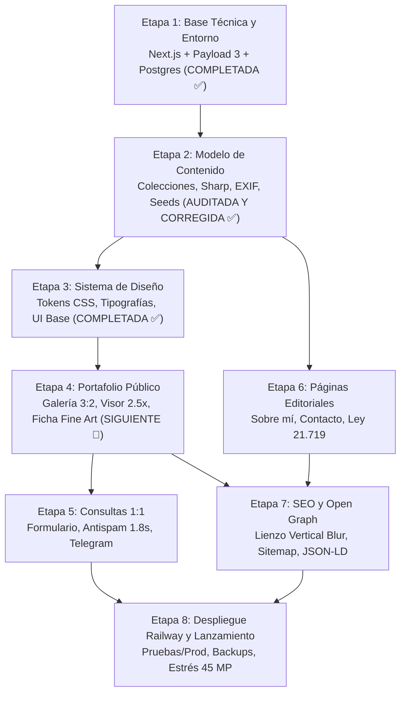

# Plan de Implementación por Etapas — Web_RodDiaz (v1.0)

> **Estado general de la documentación:** Todos los documentos técnicos de la suite v1.0 se encuentran en estado **`aprobado`** tras la auditoría integral Fine Art y difusión.
> **Fuente de verdad:** [`DocumentosTecnicos/_INDICE_MAESTRO.md`](file:///Users/roddiaz/projects/DesarrolloWeb/DocumentosTecnicos/_INDICE_MAESTRO.md) y [`DocumentosTecnicos/marco-general/marco-general-proyecto.md`](file:///Users/roddiaz/projects/DesarrolloWeb/DocumentosTecnicos/marco-general/marco-general-proyecto.md).
> **Estado de avance:** Etapa 1 completada y desplegada en Railway.

---

## 1. Evaluación de Tareas Pendientes del Usuario (¿Son Stopper?)

**Conclusión:** **Ninguna de tus tareas pendientes es stopper para arrancar y avanzar en la implementación.**
Podemos construir todo el sistema con valores semilla (*seeds*), variables opcionales y entornos de prueba sin detener el flujo de trabajo técnico.

| Tarea | Descripción | ¿Bloquea el desarrollo? | Estrategia de avance sin fricción |
|---|---|:---:|---|
| **T-004** | Límites de gasto en Railway (aviso $25 / tope $40) | **NO** | Solo se requiere antes del lanzamiento a producción. |
| **T-006** | Catálogo inicial de tamaños en cm y papeles Fine Art | **NO** | Se implementa el esquema exacto de `FormatoImpresion` y `TipoPapel`. Usaremos un catálogo semilla con los estándares Fine Art aprobados (30×45, 40×60, 50×75 cm; papeles 100% algodón y baritados Hahnemühle/Canon). Podrás editarlo desde el panel en cualquier momento. |
| **T-008** | Cliente OAuth de Google Cloud para el panel | **NO** | Para el desarrollo local y pruebas se habilita el acceso vía script de mantenimiento (`scripts/recuperar-acceso.ts`) o autenticación de desarrollo. Se enchufa Google OAuth en cuanto crees las credenciales. |
| **T-014** | Bot de Telegram (`TELEGRAM_BOT_TOKEN`, `TELEGRAM_CHAT_ID`) | **NO** | La notificación push en el Server Action está diseñada como **no bloqueante y resiliente**: si las credenciales no están presentes, la consulta se almacena con éxito en la base de datos y se registra en logs sin fallar. |
| **T-005** | Selección de 12 fotos de lanzamiento | **NO** | En desarrollo y maquetación se usan imágenes de prueba y marcadores de posición (*placeholders*). Las fotos reales se cargarán antes del lanzamiento. |
| **T-007** | Texto "Sobre mí" y foto de perfil | **NO** | Se siembra contenido de prueba en la colección `Pagina` (`sobre-mi`). |
| **T-009** | Portada, 6 destacadas y fotos de colecciones | **NO** | Configurable desde el panel `/admin` al cargar el catálogo final. |
| **T-011** | Descripción del sitio para SEO (máx. 160 caracteres) | **NO** | Se utiliza un texto semilla en `AjustesSitio`. |
| **T-013** | 3 JPG de prueba desde Lightroom (45 MP, Adobe RGB, GPS) | **NO** | Se requerirán en la Etapa 8 para la prueba de estrés de memoria en Railway. |
| **T-010** | Google Search Console y envío de sitemap | **NO** | Tarea exclusiva del día del lanzamiento. |
| **T-012** | Compra de dominio `.cl` | **NO** | Definida formalmente para la versión v1.x (fase de difusión). |

---

## 2. Mapa de Etapas de Implementación

---

### Etapa 1: Base Técnica del Proyecto y Entorno (COMPLETADA Y REVISADA ✅)
- **Objetivo:** Inicializar la arquitectura en Next.js con Payload CMS 3 en la estructura oficial de carpetas y desplegar en Railway con base de datos PostgreSQL.
- **Estado:**
  - Proyecto en Railway `web-roddiaz` creado en US East (Virginia).
  - Base de datos PostgreSQL aprovisionada con volumen y red interna.
  - Servicio `sitio` desplegado en Railway en `https://sitio-production-7f52.up.railway.app`.
  - Endpoint `GET /api/salud` respondiendo HTTP 200 `{ estado: 'ok' }` con verificación activa a Postgres (timeout 2s) y lectura en volumen de medios.
  - Cabeceras de seguridad activas en `next.config.mjs` (X-Frame-Options, X-Content-Type-Options, Referrer-Policy, Permissions-Policy).
  - Panel `/admin` operativo y respondiendo HTTP 200.
  - Compilación sin base de datos verificada con Next.js 15.2.9 y Payload CMS 3.90.2.

---

### Etapa 2: Modelo de Datos y Colecciones Payload (COMPLETADA ✅)
- **Objetivo:** Codificar las entidades del dominio respetando los nombres oficiales (sin tildes, términos de dominio en español) y el procesamiento de fotos Fine Art.
- **Colecciones implementadas:**
  - `Foto`: upload con hook en `sharp` (versiones 480, 1200 y 2048 px en AVIF/WebP + fallback JPG, conversión a sRGB preservando perfil ICC, descarte de EXIF/GPS, cálculo automático de relación de aspecto 3:2/orientación, punto focal, campo privado `nombreArchivoOriginal`).
  - `Coleccion`: árbol de 2 niveles (madre/hija), slug histórico, portada con punto focal, joins con fotos e hijas.
  - `Caracteristica`: etiquetas de filtrado transversal con slugs automáticos y slugs históricos.
  - `FormatoImpresion`: medidas en cm (`ladoCortoCm`, `ladoLargoCm`), `margenMinimoCm` (default 2.0 cm), relación con papeles y bloqueo de edición de medidas si tiene fotos asociadas.
  - `TipoPapel`: catálogo Fine Art enriquecido (`base`, `acabado`, `gramajeGsm`, `libreDeAcido`, fabricante) y protección contra borrado en cascada.
  - `Pagina`: textos con editor Lexical, protección de slugs reservados (`sobre-mi`, `contacto`, `privacidad`, `condiciones`), campo `contenidoActualizadoEn`.
  - `Consulta` y `Suscriptor`: esquema con snapshots inmutables (`nombreFormatoSnapshot`, `nombrePapelSnapshot`), estados, consentimientos Ley 21.719.
  - `Medio`, `IntentoAcceso`, actualización de `Usuario` (oculto en admin, acceso restringido) y `AjustesSitio` (logo, fotoPortada, plantillas de correo).
- **Librerías y utilidades implementadas en `src/lib/`:**
  - `slug.ts`, `proporcion.ts`, `exif.ts`, `imagenes.ts`, `visibilidad.ts`, `contenido.ts`, `acceso.ts`.
  - Suite de 14 pruebas unitarias en `src/lib/*.test.ts` pasando al 100%.
- **Tareas adicionales completadas:**
  - Script de semilla (*seed*) en `src/semilla/semilla.ts` y CLI `scripts/semilla.ts`.
  - Script de recuperación de acceso en `scripts/recuperar-acceso.ts` y ruta `/admin/recuperar`.
- **Criterio de aceptación cumplido:** Compilación de Next.js y tipados de Payload al 100% en verde; subida de foto con pipeline Sharp blindado; entidades oficiales registradas.

---

### Etapa 3: Identidad Visual y Sistema de Diseño (COMPLETADA ✅)
- **Objetivo:** Implementar la capa visual aprobada en [`sistema-de-diseno.md`](file:///Users/roddiaz/projects/DesarrolloWeb/DocumentosTecnicos/identidad/sistema-de-diseno.md).
- **Tareas completadas:**
  - Configuración de fuentes locales mediante `next/font`: *Cormorant Garamond* (títulos/editorial) y *Manrope* (lectura/interfaz) con licencia OFL en el repositorio.
  - Tokens CSS (variables nativas en `:root`): paleta grafito neutra (`--color-fondo: #151515`, etc.), espaciados en múltiplos de 4px, filetes de conservación Fine Art, capas y curvas de movimiento.
  - Estilos base (`base.css`): normalización, `color-scheme: dark`, foco accesible con doble anillo, scrollbar sobria y disuasión de descarga en imágenes.
  - Monograma "RD" en `src/app/icon.svg`.
  - Componentes base modulares: `SaltarContenido`, `Marca`, `Boton`, `Dialogo` nativo `<dialog>`, `MenuMovil` (100dvh), `Encabezado` ocultable, `Pie`, `ChipFiltro`, `Campo`, `Aviso`, `Esqueleto` (sin CLS), `MarcoFoto` (picture AVIF/WebP, filete), `Retorno`, `PlantillaEstado`, `NavegacionFotos`, `TarjetaColeccion` (ratio 4:5), `DisposicionFicha` (lateral vs franja inferior) y `Visor` a pantalla completa con navegación táctil y doble toque (*double-tap zoom* 2.5x).
  - Catálogo interactivo aislado en `/guia-estilo` (protegido contra producción con 404).
- **Criterio de aceptación cumplido:** 100% de componentes base construidos y probados en aislamiento sin dependencias externas pesadas; `next build` exitoso.

---

### Etapa 4: Portafolio Público (Galería, Ficha y Visor Fine Art)
- **Objetivo:** Construir la experiencia pública donde la obra fotográfica es la protagonista.
- **Vistas y componentes:**
  - **Portada (`/`):** foto de portada a gran tamaño, vitrina de colecciones destacadas y acceso directo al archivo completo.
  - **Galería (`/fotos` y `/colecciones/[slug]`):** grilla de filas justificadas en CSS puro que respeta el ratio nativo sin recortar fotos; scroll infinito con `IntersectionObserver` apoyado en `GET /datos/fotos`.
  - **Directorio de colecciones (`/colecciones`):** tarjetas con proporción 4:5 centradas en el punto focal.
  - **Ficha de foto (`/fotos/[slug]`):**
    - Despliegue íntegro de la fotografía con filete sutil.
    - Leyenda de taller: margen perimetral blanco de conservación y firma de autor a mano en lápiz grafito.
    - Selector interactivo de tamaños en cm y papeles Fine Art compatibles.
    - Botón de llamada a la acción "Pedir una copia".
    - Botón compartir nativo con fallback a enlace directo de WhatsApp en móviles.
  - **Visor a pantalla completa:** inspección de nitidez Fine Art con soporte de doble toque (zoom 2.5x) y navegación táctil.
  - Endpoint auxiliar `GET /datos/contexto` para transiciones fluidas de navegación.
- **Criterio de aceptación:** Navegación en máximo 2 clics desde la portada a cualquier foto; visor interactivo fluido sin librerías externas pesadas.

---

### Etapa 5: Sistema de Consultas 1:1 y Notificaciones
- **Objetivo:** Canalizar el interés del visitante hacia Rod de forma ágil y privada.
- **Tareas clave:**
  - Página `/consulta` con soporte de parámetros de URL (`?foto=...&formato=...`) y buscador dinámico (`GET /datos/fotos-consultables`). Soporte de consulta general sin foto.
  - Sistema antispam calibrado: honeypot + tiempo mínimo de llenado de 1.8 segundos (adaptado para autocompletado en navegadores móviles) + limitador de tasa por IP.
  - Server Action con mejora progresiva (funciona sin JS).
  - Persistencia de snapshots textuales de formato y papel para inmutabilidad ante cambios de catálogo.
  - Integración push a Telegram (`TELEGRAM_BOT_TOKEN`, `TELEGRAM_CHAT_ID`) de ejecución no bloqueante.
  - Gestión en `/admin`: contador de consultas `nueva`, filtrado por estado, enlace con borrador para responder desde Gmail.
  - Proceso de limpieza automática con cola de tareas de Payload: borrado a los 12 meses (y a los 30 días si es spam).
- **Criterio de aceptación:** Una consulta enviada aparece como `nueva` en el panel, genera snapshot inmutable y despacha aviso a Telegram si las variables existen.

---

### Etapa 6: Páginas Editoriales y Cumplimiento Legal
- **Objetivo:** Completar la presencia institucional y garantizar cumplimiento con la Ley 21.719 de datos personales.
- **Vistas:**
  - `/sobre-mi`: perfil fotográfico de Rod, trayectoria y selección de fotos destacadas.
  - `/contacto`: vías de comunicación con enmascaramiento `{correo}` para neutralizar bots recolectores.
  - `/privacidad`: política legal adaptada a expediciones fotográficas en terreno y cláusula de respaldos (retención de hasta 45 días).
  - `/condiciones`: propiedad intelectual (Ley 17.336), pautas de manipulación y enmarcado Fine Art.
- **Criterio de aceptación:** Las cuatro páginas reservadas cargan su contenido administrable desde Payload y cumplen con las normativas legales vigentes.

---

### Etapa 7: SEO, Open Graph y Rendimiento
- **Objetivo:** Maximizar visibilidad en Google e impacto visual en redes sociales.
- **Tareas clave:**
  - Generación de metadatos estáticos y dinámicos (`Metadata` API de Next.js).
  - Generación dinámica de lienzo Open Graph (1200 × 630) con fondo desenfocado para fotos verticales/3:2 (`/og/foto/[slug]`), óptimo para WhatsApp e Instagram.
  - Marcado estructurado JSON-LD con datos de autor, obra y licencias.
  - Generación de `sitemap.ts` y `robots.ts` adaptados según entorno (`production` indexable vs `pruebas` con `noindex`).
  - Middleware de host único (`URL_SITIO`) con redirección 301 (con excepción para `/api/salud`).
  - Desacoplamiento de compilación: `generateStaticParams` seguro para compilar sin base de datos activa.
- **Criterio de aceptación:** Compilación `next build` exitosa con base de datos apagada; metatags y tarjeta Open Graph vertical visualmente verificados.

---

### Etapa 8: Despliegue en Railway, Respaldo y Lanzamiento
- **Objetivo:** Desplegar el sistema en Railway y verificar la lista de chequeo de lanzamiento.
- **Tareas clave:**
  - Archivo `railway.json` con rutas de vigilancia (*watch patterns*) para evitar despliegues innecesarios por documentación.
  - Configuración de entornos `production` (promoción manual) y `pruebas` (serverless sleep).
  - Tarjeta de Respaldo en `/admin` con endpoint `POST /api/respaldo` (descarga comprimida `.json.gz` sin imágenes pesadas).
  - Script de consola `scripts/recuperar-acceso.ts` para emisión de enlaces de emergencia de un solo uso (15 minutos).
  - Pruebas de carga de memoria Sharp con imágenes de 45 MP (concurrencia 1, AVIF effort 3) en entorno de pruebas.
  - Chequeo final de la lista de lanzamiento antes de promover a producción.
- **Criterio de aceptación:** Sitio arriba en Railway, migraciones automáticas funcionales, chequeo de salud en verde y pruebas de memoria aprobadas.
