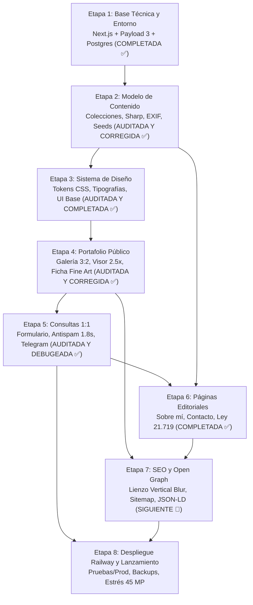

# Plan de Implementación por Etapas — Web_RodDiaz (v1.0)

> **Estado general de la documentación:** Todos los documentos técnicos de la suite v1.0 se encuentran en estado **`aprobado`** tras la auditoría integral Fine Art y difusión.
> **Fuente de verdad:** [`DocumentosTecnicos/_INDICE_MAESTRO.md`](file:///Users/roddiaz/projects/DesarrolloWeb/DocumentosTecnicos/_INDICE_MAESTRO.md) y [`DocumentosTecnicos/marco-general/marco-general-proyecto.md`](file:///Users/roddiaz/projects/DesarrolloWeb/DocumentosTecnicos/marco-general/marco-general-proyecto.md).
> **Estado de avance:** Etapas 1, 2, 3, 4, 5 (auditada y debugeada) y 6 (completada) al 100%. Próxima: Etapa 7 (SEO, Open Graph y Rendimiento).

---

## 1. Evaluación de Tareas Pendientes del Usuario (¿Son Stopper?)

**Conclusión:** **Ninguna de tus tareas pendientes es stopper para arrancar y avanzar en la implementación.**
Podemos construir todo el sistema con valores semilla (*seeds*), variables opcionales y entornos de prueba sin detener el flujo de trabajo técnico.

| Tarea | Descripción | ¿Bloquea el desarrollo? | Estrategia de avance sin fricción |
|---|---|:---:|---|
| **T-004** | Límites de gasto en Railway (aviso $25 / tope $40) | **NO** | Solo se requiere antes del lanzamiento a producción. |
| **T-006** | Catálogo inicial de tamaños en cm y papeles Fine Art | **NO** | Se implementa el esquema exacto de `FormatoImpresion` y `TipoPapel`. Usaremos un catálogo semilla con los estándares Fine Art aprobados (30×45, 40×60, 50×75 cm; papeles 100% algodón y baritados Hahnemühle/Canon). Podrás editarlo desde el panel en cualquier momento. |
| **T-008** | Cliente OAuth de Google Cloud para el panel | **NO** | Para el desarrollo local y pruebas se habilita el acceso vía script de mantenimiento (`scripts/recuperar-acceso.ts`) o autenticación de desarrollo. Se enchufa Google OAuth en cuanto crees las credenciales. |
| **T-014** | Bot de Telegram (`TELEGRAM_BOT_TOKEN`, `TELEGRAM_CHAT_ID`) | **NO** | La notificación push en el Server Action está diseñada como **no bloqueante y resiliente**: si las credenciales no están presentes, la consulta se almacena con éxito en la base de datos y se registra en logs sin fallar. |
| **T-005** | Selección de 12 fotos de lanzamiento | **NO** | En desarrollo y maquetación se usan imágenes de prueba y marcadores de posición (*placeholders*). Las fotos reales se cargarán antes del lanzamiento. |
| **T-007** | Texto "Sobre mí" y foto de perfil | **NO** | Se siembra contenido de prueba en la colección `Pagina` (`sobre-mi`). |
| **T-009** | Portada, 6 destacadas y fotos de colecciones | **NO** | Configurable desde el panel `/admin` al cargar el catálogo final. |
| **T-011** | Descripción del sitio para SEO (máx. 160 caracteres) | **NO** | Se utiliza un texto semilla en `AjustesSitio`. |
| **T-013** | 3 JPG de prueba desde Lightroom (45 MP, Adobe RGB, GPS) | **NO** | Se requerirán en la Etapa 8 para la prueba de estrés de memoria en Railway. |
| **T-010** | Google Search Console y envío de sitemap | **NO** | Tarea exclusiva del día del lanzamiento. |
| **T-012** | Compra de dominio `.cl` | **NO** | Definida formalmente para la versión v1.x (fase de difusión). |

---

## 2. Mapa de Etapas de Implementación

---

### Etapa 1: Base Técnica del Proyecto y Entorno (COMPLETADA Y REVISADA ✅)
- **Objetivo:** Inicializar la arquitectura en Next.js con Payload CMS 3 en la estructura oficial de carpetas y desplegar en Railway con base de datos PostgreSQL.
- **Estado:**
  - Proyecto en Railway `web-roddiaz` creado en US East (Virginia).
  - Base de datos PostgreSQL aprovisionada con volumen y red interna.
  - Servicio `sitio` desplegado en Railway en `https://sitio-production-7f52.up.railway.app`.
  - Endpoint `GET /api/salud` respondiendo HTTP 200 `{ estado: 'ok' }` con verificación activa a Postgres (timeout 2s) y lectura en volumen de medios.
  - Cabeceras de seguridad activas en `next.config.mjs` (X-Frame-Options, X-Content-Type-Options, Referrer-Policy, Permissions-Policy).
  - Panel `/admin` operativo y respondiendo HTTP 200.
  - Compilación sin base de datos verificada con Next.js 15.2.9 y Payload CMS 3.90.2.

---

### Etapa 2: Modelo de Datos y Colecciones Payload (COMPLETADA ✅)
- **Objetivo:** Codificar las entidades del dominio respetando los nombres oficiales (sin tildes, términos de dominio en español) y el procesamiento de fotos Fine Art.
- **Colecciones implementadas:**
  - `Foto`: upload con hook en `sharp` (versiones 480, 1200 y 2048 px en AVIF/WebP + fallback JPG, conversión a sRGB preservando perfil ICC, descarte de EXIF/GPS, cálculo automático de relación de aspecto 3:2/orientación, punto focal, campo privado `nombreArchivoOriginal`).
  - `Coleccion`: árbol de 2 niveles (madre/hija), slug histórico, portada con punto focal, joins con fotos e hijas.
  - `Caracteristica`: etiquetas de filtrado transversal con slugs automáticos y slugs históricos.
  - `FormatoImpresion`: medidas en cm (`ladoCortoCm`, `ladoLargoCm`), `margenMinimoCm` (default 2.0 cm), relación con papeles y bloqueo de edición de medidas si tiene fotos asociadas.
  - `TipoPapel`: catálogo Fine Art enriquecido (`base`, `acabado`, `gramajeGsm`, `libreDeAcido`, fabricante) y protección contra borrado en cascada.
  - `Pagina`: textos con editor Lexical, protección de slugs reservados (`sobre-mi`, `contacto`, `privacidad`, `condiciones`), campo `contenidoActualizadoEn`.
  - `Consulta` y `Suscriptor`: esquema con snapshots inmutables (`nombreFormatoSnapshot`, `nombrePapelSnapshot`), estados, consentimientos Ley 21.719.
  - `Medio`, `IntentoAcceso`, actualización de `Usuario` (oculto en admin, acceso restringido) y `AjustesSitio` (logo, fotoPortada, plantillas de correo).
- **Librerías y utilidades implementadas en `src/lib/`:**
  - `slug.ts`, `proporcion.ts`, `exif.ts`, `imagenes.ts`, `visibilidad.ts`, `contenido.ts`, `acceso.ts`.
  - Suite de 14 pruebas unitarias en `src/lib/*.test.ts` pasando al 100%.
- **Tareas adicionales completadas:**
  - Script de semilla (*seed*) en `src/semilla/semilla.ts` y CLI `scripts/semilla.ts`.
  - Script de recuperación de acceso en `scripts/recuperar-acceso.ts` y ruta `/admin/recuperar`.
- **Criterio de aceptación cumplido:** Compilación de Next.js y tipados de Payload al 100% en verde; subida de foto con pipeline Sharp blindado; entidades oficiales registradas.

---

### Etapa 3: Identidad Visual y Sistema de Diseño (COMPLETADA Y AUDITADA ✅)
- **Objetivo:** Implementar la capa visual aprobada en [`sistema-de-diseno.md`](file:///Users/roddiaz/projects/DesarrolloWeb/DocumentosTecnicos/identidad/sistema-de-diseno.md).
- **Tareas completadas:**
  - Configuración de fuentes locales mediante `next/font`: *Cormorant Garamond* (títulos/editorial) y *Manrope* (lectura/interfaz) con licencia OFL en el repositorio.
  - Tokens CSS (variables nativas en `:root`): paleta grafito neutra (`--color-fondo: #151515`, etc.), espaciados en múltiplos de 4px, filetes de conservación Fine Art, capas y curvas de movimiento.
  - Estilos base (`base.css`): normalización, `color-scheme: dark`, foco accesible con doble anillo, scrollbar sobria y disuasión de descarga en imágenes.
  - Monograma "RD" en `src/app/icon.svg`.
  - Componentes base modulares: `SaltarContenido`, `Marca`, `Boton`, `Dialogo` nativo `<dialog>`, `MenuMovil` (100dvh), `Encabezado` ocultable, `Pie`, `ChipFiltro`, `Campo`, `Aviso`, `Esqueleto` (sin CLS), `MarcoFoto` (picture AVIF/WebP, filete), `Retorno`, `PlantillaEstado`, `NavegacionFotos`, `TarjetaColeccion` (ratio 4:5), `DisposicionFicha` (lateral vs franja inferior) y `Visor` a pantalla completa con navegación táctil y doble toque (*double-tap zoom* 2.5x).
  - Catálogo interactivo aislado en `/guia-estilo` (protegido contra producción con 404).
  - Auditoría y blindaje: corrección de ciclo de vida en `Dialogo`, scroll suave a instantáneo en bloqueo, tipografía sin faux-bold, orden canónico de navegación, precarga a 1200px en `Visor` y CTA garantizado en top 360px en vertical.
- **Criterio de aceptación cumplido:** 100% de componentes base construidos y probados en aislamiento sin dependencias externas pesadas; `next build` exitoso.

---

### Etapa 4: Portafolio Público (COMPLETADA Y AUDITADA ✅)
- **Objetivo:** Construir la experiencia pública donde la obra fotográfica es la protagonista según especificaciones de [`galeria-colecciones.md`](file:///Users/roddiaz/projects/DesarrolloWeb/DocumentosTecnicos/interaccion/galeria-colecciones.md) y [`ficha-foto.md`](file:///Users/roddiaz/projects/DesarrolloWeb/DocumentosTecnicos/interaccion/ficha-foto.md).
- **Vistas y componentes implementados:**
  - **Paginación y dominio (`src/lib/`):**
    - `cursor.ts` y `cursor.test.ts`: paginación por cursor opaco URL-safe base64.
    - `ficha.ts` y `ficha.test.ts`: funciones puras de dominio (`orientarFormato`, `etiquetaProporcion`, `resumenCopias`, `fechaVisible`, `datosTecnicosVisibles`, `hrefConsulta`, `masDeCircular`).
    - `contenido.ts`: mapeo público y consultas de portafolio sin fugas de información interna.
  - **Endpoints auxiliares:**
    - `GET /datos/fotos`: alimentación paginada de grilla justificadas por cursor con soporte de filtros (`coleccion`, `caracteristica`).
    - `GET /datos/contexto`: recuperación ultraliviana de fotos anterior/siguiente de colección para navegación en `Visor` y `Ficha`.
  - **Portada (`/`):**
    - `PortadaSitio.tsx`: foto a gran formato ocupando ventana visible con aire perimetral, pie discreto y vitrina editorial de colecciones destacadas con acceso directo a todo el archivo.
  - **Galería (`/fotos` y `/colecciones/[slug]`):**
    - `GrillaFotos.tsx`: filas justificadas en CSS puro (flexbox con `--alto-fila`) respetando ratios nativos sin recortes; altura mínima de 28px reservada para títulos en hover evitando solapamientos.
    - `CargaInfinita.tsx`: carga reactiva con `IntersectionObserver`, restauración de estado desde `sessionStorage` para retorno fluido sin re-scroll, fila de `Esqueleto` durante carga y reintento en caso de error de red.
    - `CabeceraColeccion.tsx`, `FiltroCaracteristicas.tsx` (chips con scroll horizontal táctil) y `SeccionHija.tsx`.
  - **Directorio de colecciones (`/colecciones`):**
    - `RejillaColecciones.tsx`: rejilla responsiva (3/2/1 columnas) con tarjetas 4:5 centradas en punto focal.
  - **Ficha Fine Art (`/fotos/[slug]`):**
    - `Ficha.tsx` y `DisposicionFicha.tsx`: dos columnas en escritorio vertical/cuadrada (columna sticky derecha con CTA "Pedir una copia" en los primeros 360px); franja inferior continua en fotos horizontales/panorámicas.
    - `MetaFoto.tsx`, `ResumenCopias.tsx`, `EleccionCopia.tsx`: selector reactivo de formatos y papeles compatibles.
    - `TamanosPapeles.tsx`: acordeón nativo `
` con leyenda de taller destacando el margen perimetral blanco de conservación y firma a mano en lápiz grafito.
    - `BarraCopiaMovil.tsx`: barra inferior fija en pantallas móviles activada mediante `IntersectionObserver` cuando el botón principal sale de pantalla.
    - `Historia.tsx`: texto colapsable con `line-clamp: 4` y botón "Leer más".
    - `DatosTecnicos.tsx` y `CaracteristicasFoto.tsx`: metadatos de toma EXIF limpios y etiquetas temáticas.
    - `Compartir.tsx`: Web Share API nativa con copia a portapapeles (feedback 2s) y fallback directo a WhatsApp.
    - `MasDeColeccion.tsx`: carrusel circular de hasta 6 fotos de la misma serie.
    - `ContextoFicha.tsx`: integración fluida con `Visor` (atajos ← / →, inspección de nitidez a doble toque 2.5x).
- **Auditoría y correcciones aplicadas:**
  - Botón CTA en `Visor` sincronizado reactivamente con la foto activa en el carrusel y ocultado en fotos de vitrina (§3.6).
  - Ubicación de la línea del formato seleccionado ("30 × 45 cm · Quitar") bajo el botón primario en disposición horizontal y vertical (§3.1).
  - Navegación inteligente en `Retorno` con `history.back()` cuando el usuario proviene de la misma lista de galería (§3.5).
  - Restauración y salto instantáneo a la posición de la foto en la galería mediante `sessionStorage` en `ItemGrilla` y `CargaInfinita` (§3.7).
  - Doble acción ("Ver todas las fotos" y "Ver <colección>") en `FotoNoDisponible` para fotos despublicadas (§3.8).
- **Criterio de aceptación cumplido:** Pruebas unitarias al 100%; compilación de producción en Next.js limpia sin base de datos activa; navegación fluida en ≤ 2 clics; sin imágenes de 2048px en la galería.

---

### Etapa 5: Sistema de Consultas 1:1 y Notificaciones (COMPLETADA Y VERIFICADA ✅)
- **Objetivo:** Canalizar el interés del visitante hacia Rod de forma ágil y privada cumpliendo con la Ley 21.719.
- **Implementación realizada:**
  - **Librería de dominio y antispam (`src/lib/consultas.ts` y `src/lib/limiteEnvios.ts`):**
    - Detección de errores comunes de dominio de correo (`sugerirCorreo` para `gmail.com`, `hotmail.com`, etc.).
    - Token HMAC firmado con `PAYLOAD_SECRET` y tiempo mínimo de llenado de 1.8 segundos (`firmarEmision`, `verificarEmision`, `clasificarSpam`).
    - Límite de tasa por IP en memoria (5 envíos/hora) con sal diaria volátil y sin almacenar IPs en disco.
    - Función de inmutabilidad y cálculo de purga `calcularEliminarDespuesDe` (12 meses o 30 días spam).
    - Generador de URLs de respuesta por Gmail y mailto con sustitución de plantillas (`urlRespuestaGmail`).
    - Indicador mensual de consultas de copia recibidas vs respondidas (`indicadorMensual`).
    - Informe de transparencia de datos personales en texto plano (`exportarDatosCorreo`).
    - Suite completa de pruebas en `src/lib/consultas.test.ts` (10 pruebas adicionales, totalizando 33 pruebas unitarias al 100%).
  - **Notificaciones push instantáneas (`src/lib/telegram.ts`):**
    - Aviso asíncrono no bloqueante vía Bot de Telegram (`TELEGRAM_BOT_TOKEN`, `TELEGRAM_CHAT_ID`) tras guardado exitoso sin comprometer la respuesta al visitante.
  - **Colecciones y globales Payload:**
    - `Consulta`: acceso restringido a `Usuario` (creación pública exclusiva vía Server Action con `overrideAccess`), hooks automáticos de `tipo`, `ultimaActividad`, `respondidaEn` y `eliminarDespuesDe`.
    - `AjustesSitio`: valores oficiales aprobados para textos de introducción, recepción, consentimiento (Ley 21.719), novedades y plantilla de respuesta.
  - **Endpoint de búsqueda de fotos (`GET /datos/fotos-consultables`):**
    - Entrega liviana de fotos visibles que ofrecen copia, con formatos orientados y búsqueda normalizada sin tildes.
  - **Server Action (`src/app/(sitio)/consulta/acciones.ts`):**
    - `enviarConsulta` con mejora progresiva (soporte sin JS), idempotencia por `claveEnvio`, verificación de honeypot y tasa por IP, persistencia de snapshots inmutables de catálogo (`nombreFormatoSnapshot`, `nombrePapelSnapshot`), y alta en `Suscriptor` si aceptó novedades.
  - **Página y componentes públicos (`/consulta`):**
    - `page.tsx`: servida dinámicamente, directiva `noindex, nofollow`, resolución de `?foto=...&formato=...&origen=...`, avisos informativos para fotos no disponibles o de vitrina sin generar 404.
    - `FormularioConsulta.tsx`: formulario en dos columnas escritorio / apilado móvil con `useActionState`, validación al desenfocar (`onBlur`), resumen de errores accesible y botón con feedback de envío.
    - `ItemsConsulta.tsx` e `ItemConsulta.tsx`: lista de hasta 5 obras, selectores dependientes de formato y papel, miniatura 72px y anuncio `aria-live` al quitar.
    - `BuscadorFotos.tsx`: modal con búsqueda reactiva sin tildes, miniaturas de catálogo y selección directa.
    - `SugerenciaCorreo.tsx`: sugerencia interactiva con un toque para correos mal escritos.
    - `ExitoConsulta.tsx`: estado de confirmación con animación de trazo SVG sobria (≤ 300ms) y foco accesible en el título.
  - **Componentes de administración en `/admin`:**
    - `ContadorConsultas.tsx`: globo indicador de nuevas consultas en el menú.
    - `TarjetaConsultasNuevas.tsx`: tarjeta del dashboard con conteo y antigüedad de la más antigua.
    - `TarjetaConsultasPorMes.tsx`: gráfico de barras en CSS nativo para 12 meses (recibidas vs respondidas) y conteo de generales.
    - `AccionesConsulta.tsx`: responder por Gmail, mailto alternativo y transiciones de estado.
    - `OtrasConsultasCorreo.tsx`: historial de consultas del mismo titular.
    - `DatosDeCorreo.tsx`: descarga de informe `.txt` y supresión total de datos.
    - `AccionesSuscriptores.tsx`: copia masiva para CCO y gestión de bajas.
  - **Tarea programada de purga:**
    - `src/tareas/borrarConsultasVencidas.ts` integrada a la cola diaria.
  - **Auditoría y debugeo completados (Rol Auditor/Debugger):**
    - Corrección de desborde de meses en días 29-31 en `indicadorMensual` (`src/lib/consultas.ts`).
    - Migración a HTML parse mode con escape de entidades en `notificarTelegramConsulta` (`src/lib/telegram.ts`) previniendo caídas 400 Bad Request por caracteres especiales o guiones bajos del usuario.
    - Incorporación de índices de base de datos (`correo`, `estado`, `eliminarDespuesDe`, `createdAt`, `claveEnvio` único) y selector oficial `origen` con permisos de solo lectura en `Consulta.ts`.
    - Hook `afterChange` en `Consulta.ts` para registrar/actualizar `Suscriptor` automáticamente cuando una consulta marcada como spam es promovida a `nueva` ("No es spam") con la casilla de novedades marcada (§4, §5.2.13).
    - Inclusión del total de suscriptores a novedades en la cabecera de `TarjetaConsultasPorMes.tsx`.
    - Blindaje de `ajustes()` y `fotosVisibles()` con `try/catch` para garantizar compilación Next.js limpia sin base de datos activa.
- **Criterio de aceptación cumplido:** 35/35 pruebas unitarias en verde; compilación Next.js 15 exitosa; persistencia inmutable de snapshots; notificación push por Telegram blindada; y antispam calibrado sin fricción.

---

### Etapa 6: Páginas Editoriales y Cumplimiento Legal (COMPLETADA ✅)
- **Objetivo:** Completar la presencia institucional y garantizar cumplimiento con la Ley 21.719 de datos personales y Ley 17.336 de propiedad intelectual según [`paginas.md`](file:///Users/roddiaz/projects/DesarrolloWeb/DocumentosTecnicos/paginas/paginas.md).
- **Componentes y arquitectura implementados (Rol Desarrollador):**
  - `src/lib/rutasReservadas.ts`: definición estricta de rutas de sistema (`fotos`, `colecciones`, `consulta`, `admin`, `api`, `datos`, `sitemap.xml`, `robots.txt`, `guia-estilo`, `og`, etc.) y páginas institucionales reservadas, con helpers `esRutaReservada` y `esPaginaReservada`.
  - `src/colecciones/Pagina.ts`: protección contra colisiones de slugs en páginas libres ("Ese nombre ya lo usa el sitio. Elige otro."), validación obligatoria de título y contenido para publicar, inmutabilidad de slugs en páginas reservadas, y bloqueo contra borrador o eliminación de la política de privacidad.
  - `src/componentes/paginas/CorreoProtegido.tsx`: técnica de disuasión contra bots raspadores con renderizado SSR en texto ("usuario [arroba] dominio" con atributos data) e hidratación client-side interactiva a enlace `mailto:`.
  - `src/componentes/paginas/TextoEnriquecido.tsx`: serializador seguro de nodos Lexical (párrafos, h2/h3 con IDs anclables para navegación intra-página, listas, citas, enlaces con `rel="noopener"`, negrita/cursiva) y sustitución automática del marcador `{correo}`.
  - `src/componentes/paginas/paginas.module.css`: estilos editoriales con límite de 65ch, columna de lectura, tipografía `--texto-lectura`, foto de perfil sticky 40% ancho en escritorio y disposición apilada en móvil.
  - `src/componentes/paginas/PlantillaSobreMi.tsx`: perfil fotográfico de Rod con foto de perfil en `MarcoFoto` modo `ficha` (LCP prioritario), texto editorial, vitrina de hasta 6 fotos destacadas (`fotosDestacadas(6)`) y botón secundario "Escríbeme".
  - `src/componentes/paginas/PlantillaContacto.tsx`: página de contacto minimalista con botón primario "Escríbeme" hacia `/consulta` sin parámetros, enlace a Instagram con `rel="me noopener"` y **sin dirección de correo visible** en la vista ni en el HTML por decisión de Rod (§3.2).
  - `src/componentes/paginas/PlantillaTexto.tsx`: plantilla de lectura sobria para `/privacidad`, `/condiciones` y páginas libres, con fecha de actualización formateada en español para las legales y botón `Retorno`.
  - `src/lib/contenido.ts`: funciones públicas `paginaPorSlug` (resolución de páginas publicadas y redirección 308 para slugs anteriores) y `paginasEnNavegacion` (consulta liviana de páginas reservadas publicadas).
  - Integración dinámica en `layout.tsx`, `Encabezado.tsx` y `Pie.tsx`: visualización condicional de enlaces institucionales en encabezado, menú móvil y pie únicamente si sus páginas están publicadas.
  - Vistas públicas: `/sobre-mi`, `/contacto` y `/[slug]` (con soporte de `generateStaticParams` desacoplado de la base de datos).
  - Semilla oficial `src/semilla/paginas.ts`: textos aprobados completos de los Anexos A (Política de privacidad con plazos adaptados a expediciones) y B (Condiciones de uso con pautas de manipulación y enmarcado Fine Art de museo).
- **Criterio de aceptación cumplido:** 35/35 pruebas unitarias en verde; compilación `next build` exitosa con todas las rutas estáticas y dinámicas generadas en 102 kB First Load JS; cumplimiento normativo íntegro (Ley 21.719 / 19.628 / 17.336).

---

### Etapa 7: SEO, Open Graph y Rendimiento
- **Objetivo:** Maximizar visibilidad en Google e impacto visual en redes sociales.
- **Tareas clave:**
  - Generación de metadatos estáticos y dinámicos (`Metadata` API de Next.js).
  - Generación dinámica de lienzo Open Graph (1200 × 630) con fondo desenfocado para fotos verticales/3:2 (`/og/foto/[slug]`), óptimo para WhatsApp e Instagram.
  - Marcado estructurado JSON-LD con datos de autor, obra y licencias.
  - Generación de `sitemap.ts` y `robots.ts` adaptados según entorno (`production` indexable vs `pruebas` con `noindex`).
  - Middleware de host único (`URL_SITIO`) con redirección 301 (con excepción para `/api/salud`).
  - Desacoplamiento de compilación: `generateStaticParams` seguro para compilar sin base de datos activa.
- **Criterio de aceptación:** Compilación `next build` exitosa con base de datos apagada; metatags y tarjeta Open Graph vertical visualmente verificados.

---

### Etapa 8: Despliegue en Railway, Respaldo y Lanzamiento
- **Objetivo:** Desplegar el sistema en Railway y verificar la lista de chequeo de lanzamiento.
- **Tareas clave:**
  - Archivo `railway.json` con rutas de vigilancia (*watch patterns*) para evitar despliegues innecesarios por documentación.
  - Configuración de entornos `production` (promoción manual) y `pruebas` (serverless sleep).
  - Tarjeta de Respaldo en `/admin` con endpoint `POST /api/respaldo` (descarga comprimida `.json.gz` sin imágenes pesadas).
  - Script de consola `scripts/recuperar-acceso.ts` para emisión de enlaces de emergencia de un solo uso (15 minutos).
  - Pruebas de carga de memoria Sharp con imágenes de 45 MP (concurrencia 1, AVIF effort 3) en entorno de pruebas.
  - Chequeo final de la lista de lanzamiento antes de promover a producción.
- **Criterio de aceptación:** Sitio arriba en Railway, migraciones automáticas funcionales, chequeo de salud en verde y pruebas de memoria aprobadas.
